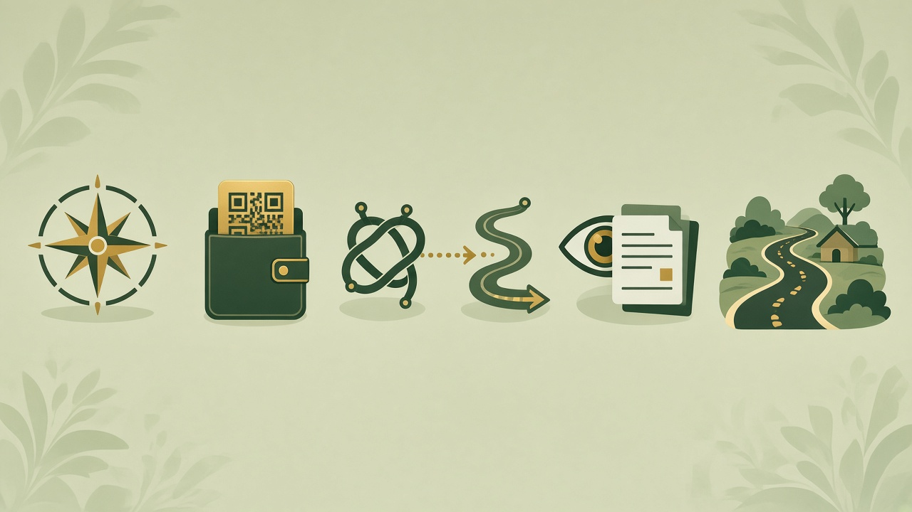
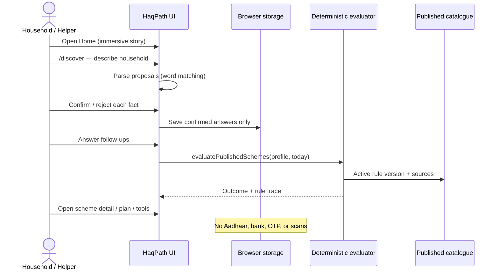
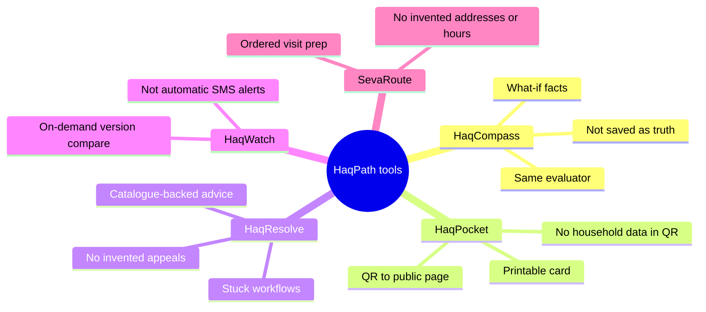
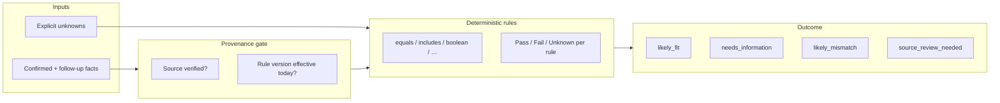
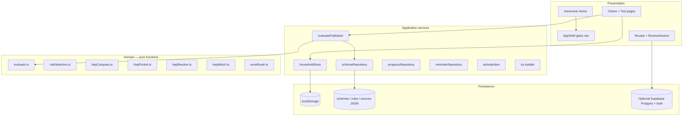
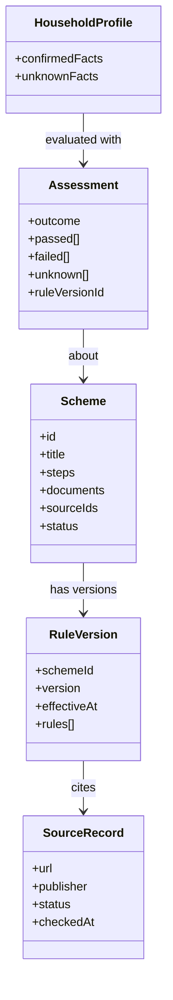
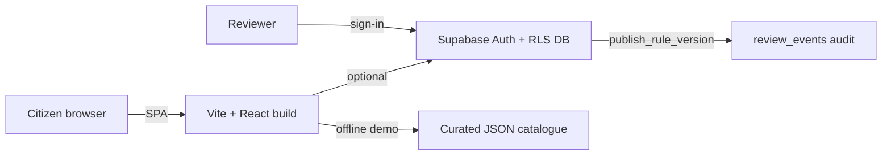
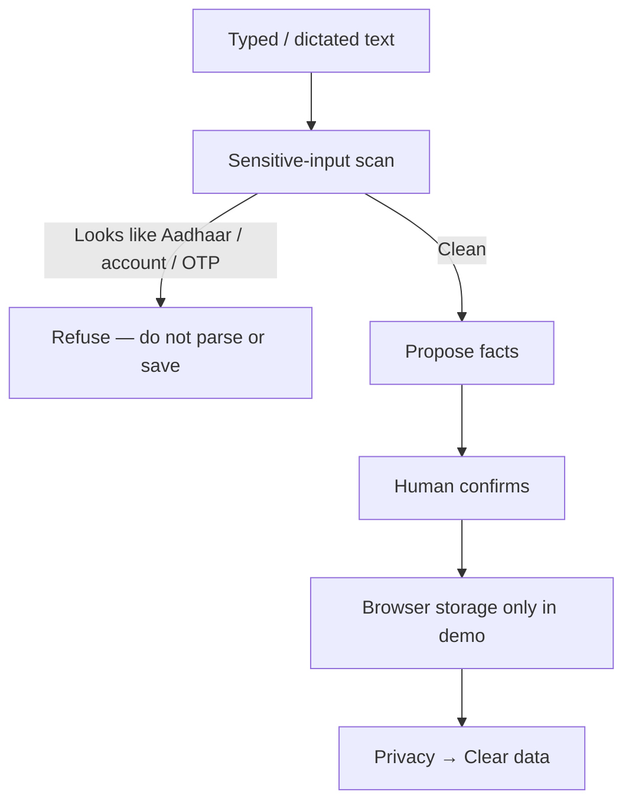

# HaqPath by SevaKrit

<p align="center">
  
</p>

**Start with what you know.** Describe a Baiga, Bharia or Sahariya household in Madhya Pradesh → see possible benefits with rule evidence → prepare papers and next steps.

> **In one sentence:** HaqPath helps families understand which published benefits *might* fit them, why the rules say that, and what to prepare next — without Aadhaar, bank details, or OTPs on this site.

Independent readiness guide — **not a government portal**. Decisions stay with the department. Details live on the in-app Privacy page.



**License:** [MIT](./LICENSE)

---

## Table of contents

1. [For everyone (plain language)](#1-for-everyone-plain-language)
2. [Who it is for](#2-who-it-is-for)
3. [What you can do here](#3-what-you-can-do-here)
4. [Citizen journey (story map)](#4-citizen-journey-story-map)
5. [The five signature tools](#5-the-five-signature-tools)
6. [How eligibility works (no magic)](#6-how-eligibility-works-no-magic)
7. [System architecture (UML-style)](#7-system-architecture-uml-style)
8. [Screens & routes](#8-screens--routes)
9. [Privacy & safety](#9-privacy--safety)
10. [Design language](#10-design-language)
11. [What we reused from Nagarakshak (and what we refused)](#11-what-we-reused-from-nagarakshak-and-what-we-refused)
12. [Run locally](#12-run-locally)
13. [Optional Supabase backend](#13-optional-supabase-backend)
14. [Tests & quality gates](#14-tests--quality-gates)
15. [Honest limits & blockers](#15-honest-limits--blockers)

---

## 1. For everyone (plain language)

Imagine a family knows they struggle with housing or livelihood, but **does not know the scheme’s official name**.

HaqPath lets them:

1. **Describe** the household in ordinary words (or with a helper in Assisted mode).
2. **Confirm** what the app thinks it understood — nothing is trusted silently.
3. **Answer** only the follow-up questions that can change the result.
4. **See** results as **Likely fit / Needs information / Likely mismatch / Source under review**.
5. **Open** a plan with documents, steps, personal reminders, and a printable sheet.
6. **Use tools** like what-if simulation, QR pocket card, troubleshooting, rule-version watch, and visit preparation.

```mermaid
flowchart TD
  A["Family or helper opens HaqPath"] --> B["Describe household in plain words"]
  B --> C["Confirm each fact"]
  C --> D["Answer only decisive questions"]
  D --> E{"Rule check against published catalogue"}
  E -->|Likely fit| F["Plan · print · reminders"]
  E -->|Needs information| G["Ask missing facts / HaqResolve"]
  E -->|Likely mismatch| H["Explain which rule failed"]
  E -->|Source under review| I["Do not pretend confidence"]
  F --> J["Family goes to official office / portal"]
  J --> K["Department decides — not HaqPath"]
```



---

## 2. Who it is for

| Audience | How HaqPath helps |
| --- | --- |
| **Baiga, Bharia, Sahariya households in Madhya Pradesh** | Plain-language checks against verified scheme rules |
| **Community volunteers / NGO helpers** | Assisted mode with consent + clear/reset between households |
| **Scheme reviewers** | Draft/publish path via Supabase Auth + database roles (when configured) |
| **Hackathon / product judges** | Explainable engine, privacy design, five signature tools, immersive UI |

**Demo lead persona:** a *synthetic* Baiga household in Dindori (not a real person’s data).

---

## 3. What you can do here

| Capability | Meaning in everyday words |
| --- | --- |
| Benefits discovery | “Which published scheme might fit us?” |
| Explainable eligibility | “Show me the rule and the official source.” |
| Application readiness | “What papers / steps are listed for preparation?” |
| Personal progress | “I mark what *I* did — this is not official status.” |
| Reminders | Personal calendar file (`.ics`), clearly not a government deadline unless verified |
| Hindi / English UI | Product translation — **not** a certified government translation |
| Reviewer publishing | Only with real DB permission — never a fake `isAdmin = true` switch |

---

## 4. Citizen journey (story map)



---

## 5. The five signature tools



| Tool | Route | Layman meaning |
| --- | --- | --- |
| **HaqCompass** | `/tools/compass` | “What if our house were pucca?” — compare without changing saved answers |
| **HaqPocket** | `/tools/pocket` | Pocket/print card + QR that opens a **public** scheme page only |
| **HaqResolve** | `/tools/resolve` | “We’re stuck — what can we safely do next?” |
| **HaqWatch** | `/tools/watch` | “Did the published rules change since we last checked?” |
| **SevaRoute** | `/tools/route` | “In what order should we prepare / visit, using listed steps only?” |

---

## 6. How eligibility works (no magic)



**Rules of honesty**

- AI / speech may help **type** a description; they **never** decide eligibility alone.
- Conflicting or unverified sources block confident claims.
- Draft schemes never appear as confirmed recommendations.
- Plan pages use **likely_fit** schemes only (not the whole catalogue).

---

## 7. System architecture (UML-style)

### 7.1 Component view



### 7.2 Class-style domain sketch



### 7.3 Deployment / runtime view



---

## 8. Screens & routes

| Route | Purpose |
| --- | --- |
| `/` | Immersive glass / CSS-3D landing + nine story chapters |
| `/login` | Guest or Supabase sign-in |
| `/workspace` | Hub after entry (gated: guest or signed-in) |
| `/discover` | Intake, confirm, follow-ups, optional dictation |
| `/results` | Four outcome sections + links to Compass / Watch |
| `/schemes/:slug` | Evidence, documents, path |
| `/public/schemes/:slug` | QR destination — **no household answers** |
| `/plan` | Readiness, progress, ICS, tool links |
| `/plan/print` | Printable action sheet |
| `/tools/*` | Compass, Pocket, Resolve, Watch, SevaRoute |
| `/assisted` | Consent-first helper journey |
| `/help` `/how-it-works` `/glossary` `/privacy` `/samples` | Trust & education |
| `/review` | Catalogue + reviewer Auth UI (DB still decides publish rights) |

---

## 9. Privacy & safety



**Never collected here:** Aadhaar / ID numbers, bank details, OTPs, document scans.

**QR cards:** only encode a public scheme URL (`/public/schemes/...`).

---

## 10. Design language

| Token | Value | Role |
| --- | --- | --- |
| Forest green | `#173B35` | Brand, primary actions |
| Warm ivory | `#F7F5F0` | Canvas |
| Sage | `#ECF1EC` | Soft sections |
| Earth | `#9C552E` | Accents / nav emphasis |
| Gold wash | `#CBB97C` | Light atmospheric highlights |
| Display | Newsreader | Editorial headlines |
| UI | Inter + Noto Sans Devanagari | Body / Hindi |

**Landing craft:** glass panels, soft atmosphere gradients, CSS perspective “3D” image stage, floating cards, reduced-motion safe.

Illustrative story images live in `public/images/story/` and are **not** photographs of verified beneficiaries.

---

## 11. What we reused from Nagarakshak (and what we refused)

Nagarakshak (`https://github.com/Rehan-2024/nagarakshak`) is a **civic complaint / governance** product. HaqPath is a **benefits readiness** product.

| Adapted pattern | HaqPath home |
| --- | --- |
| Session safety + Auth provider ideas | `AuthContext`, `CitizenGate`, `ReviewerGate` |
| Empty / spinner / dialog UX | `components/ui/*` |
| Query timeout helper | `lib/queryWithTimeout.ts` |
| Signup profile trigger idea | `supabase/migrations/004_citizen_profiles.sql` |
| Speech dictation (browser API) | Intake dictation — never decides eligibility |
| Notification *list* UX | Local `activityInbox` (not government SMS) |

| Explicitly **not** imported |
| --- |
| Complaint tickets, maps, wards, Hyderabad geo |
| Feed / billboard / municipal routing |
| Governance AI scoring / Gemini pipeline |
| CityHead / MP staff role trees as product identity |

---

## 12. Run locally

```bash
npm install
npm run dev
```

Open `http://127.0.0.1:5173/`.

Useful scripts:

| Script | Purpose |
| --- | --- |
| `npm run typecheck` | TypeScript |
| `npm run lint` | ESLint |
| `npm test` | Vitest unit suite |
| `npm run build` | Production build |
| `npm run test:e2e` | Playwright |
| `npm run test:rls:sql` | SQL RLS harness (needs local Postgres) |

---

## 13. Optional Supabase backend

Without env keys, the citizen journey runs on the **local curated catalogue**.

When `VITE_SUPABASE_URL` and `VITE_SUPABASE_ANON_KEY` are set:

- Reviewers can sign in
- `publish_rule_version` and RLS enforce real permissions
- Migrations `001`–`004` define product schema, reviewer audit, citizen profiles

**Never put the service-role key in the frontend.**

---

## 14. Tests & quality gates

Aim before release claims:

1. `typecheck` + `lint` + `test` + `build`
2. Playwright citizen journey + innovations
3. Manual check at 320 / 360 / 768 / 1024 / 1440 widths
4. Confirm images, Hindi toggle, print, ICS, clear-data
5. If Docker available: `test:rls:sql`

---

## 15. Honest limits & blockers

| Topic | Status |
| --- | --- |
| Live hosted Supabase project | Needs real project credentials |
| Full `supabase start` on constrained Windows hosts | May be blocked by Docker / disk |
| Vercel production URL | Only if hosting access is configured |
| Government translation certification | Not claimed |
| Automatic government application status | Not available — by design |
| Extra schemes beyond verified PM-JANMAN housing publish | Remain draft until evidence is verified |

---

## Credits

- **Product:** HaqPath by SevaKrit — Problem Statement 5 (Citizens and Public Services)
- **Reference engineering patterns:** Nagarakshak (adapted, not cloned as a civic app)
- **License / reuse:** Prefer native reimplementation; do not assume every upstream file is freely redistributable without checking ownership and competition rules

---

### Quick start for a first-time visitor

1. Open the home story.
2. Tap **Find possible benefits**.
3. Use the example, confirm facts, answer Rural + No (government employee) for the demo path.
4. Read **Likely fit**, then open **Plan** or any tool in the HaqPath tools rail.
5. Clear your data anytime from **Privacy**.
