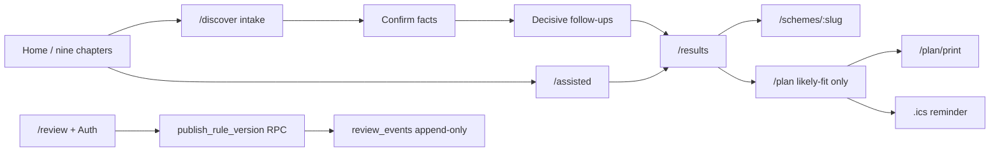
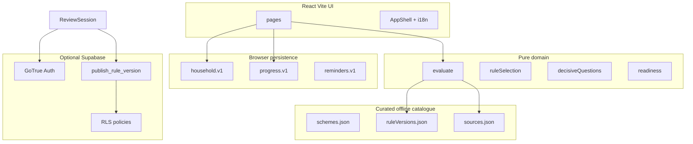

# HaqPath by SevaKrit

Independent, multilingual, explainable **benefits discovery and application-readiness** companion for Madhya Pradesh PVTG households (demo lead: synthetic Baiga household in Dindori).

**Not a government portal.** Results are rule comparisons, never approvals. No Aadhaar, bank numbers, OTPs, or document scans.

## Product map



## Architecture



## Routes

| Route | Job |
| --- | --- |
| `/` | Nine-chapter editorial home + story images |
| `/discover` | Typed intake, confirm, follow-ups |
| `/results` | Four outcome buckets from one evaluator |
| `/schemes/:slug` | Rule trace, sources, steps |
| `/plan` | Likely-fit readiness, progress, ICS |
| `/plan/print` | A4 action sheet |
| `/assisted` | Guided helper consent + reset |
| `/help`, `/how-it-works`, `/glossary`, `/privacy` | Trust and privacy |
| `/samples` | Synthetic household outcomes |
| `/review` | Catalogue + Supabase sign-in when configured |

## Outcomes

| Internal id | Citizen label | Meaning |
| --- | --- | --- |
| `likely_fit` | Likely fit / संभावित योग्यता | Confirmed answers meet reviewed rules |
| `needs_information` | Needs information | Missing or unknown fact |
| `likely_mismatch` | Likely mismatch | Confirmed answer conflicts with a reviewed rule |
| `source_review_needed` | Source under review | Stale / unverified / conflicting source |

## Setup

```bash
npm install
npm run typecheck
npm run lint
npm run test
npm run build
npm run test:e2e
npm run dev
```

### Local Supabase (optional, for reviewer RLS)

Requires Docker Desktop. This repo remaps ports to **54421+** so it can run beside another local Supabase project.

```bash
npm run supabase:start
# then copy API URL + anon + service_role + DB URL into the shell (never commit them)
npx supabase status -o env
npm run test:rls
```

Environment names only (see `.env.example`):

- `VITE_SUPABASE_URL`
- `VITE_SUPABASE_ANON_KEY`

Never put a service-role key in a `VITE_` variable.

### Deploy (Vercel)

`vercel.json` provides SPA rewrites and security headers. From a machine with Vercel access:

```bash
npx vercel --prod
```

Set production env vars in the Vercel project UI if a hosted Supabase project is connected.

## Design tokens

| Token | Hex |
| --- | --- |
| Canvas | `#F7F5F0` |
| Brand / forest | `#173B35` |
| Sage muted | `#ECF1EC` |
| Earth | `#9C552E` |
| Fonts | Newsreader, Inter, Noto Sans Devanagari |

## Evidence honesty

- Published demo scheme: **PM-JANMAN rural housing (MP)** from CM Helpline Schemeid=974 (record verification date on the catalogue row).
- Documents and deadline remain **unstated / null** when the source does not list them — never invented.
- Aahar Anudan and dairy remain **draft**.
- Story images are **AI-generated illustrations**, not documentary photos of beneficiaries.
- Nagarakshak is an owned sibling reference for auth/RLS/audit *patterns*; civic complaint/map modules are **not** ported into HaqPath.

## Tests

| Layer | Command | What it proves |
| --- | --- | --- |
| Static | `typecheck`, `lint`, `build` | Contracts compile |
| Unit | `npm test` | Engine, ICS, sensitive input, demo households |
| Browser | `npm run test:e2e` | Citizen journey + responsive routes |
| RLS | `npm run test:rls` | Real local Postgres roles (when stack is up) |

## Status

See `STATUS.md` for the latest verified checkpoint, blockers, and exact commands run.
